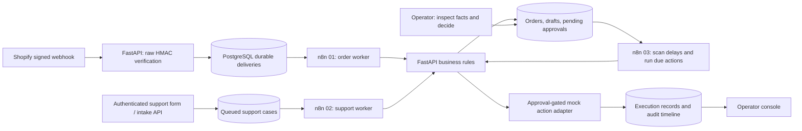
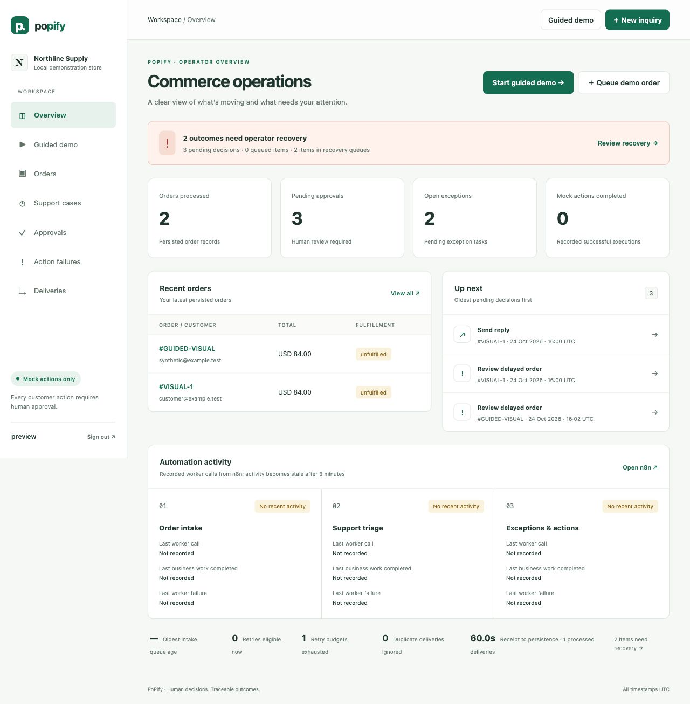
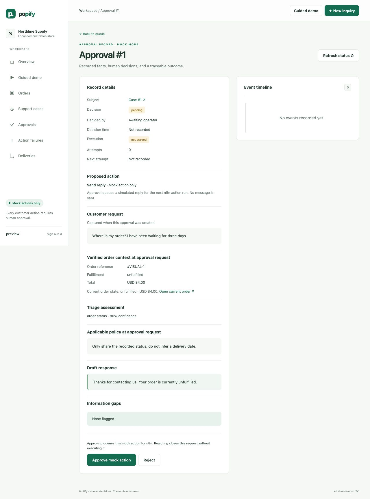
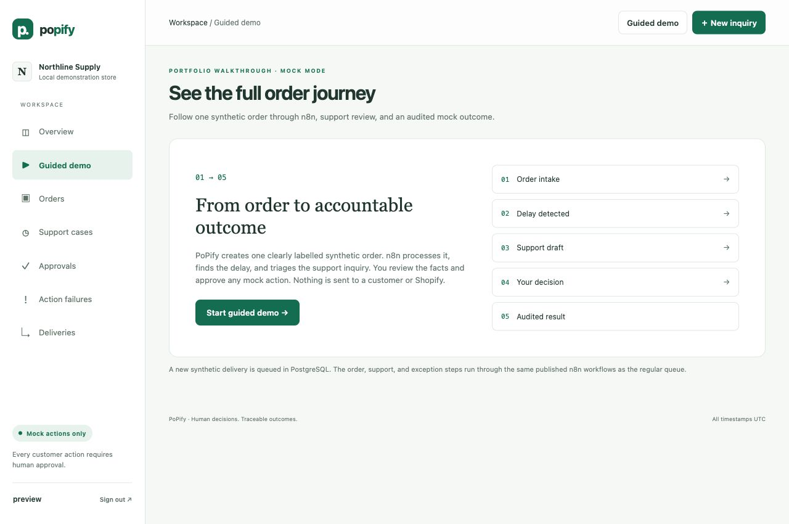
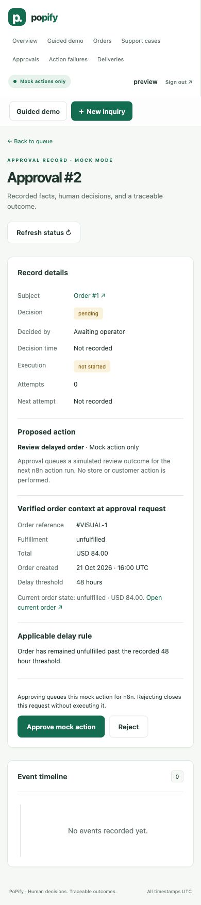

# PoPify

A local e-commerce operations demonstration: receive an order, detect a delay, prepare a grounded reply, request human approval, and audit a **mock** outcome. Three n8n workflows orchestrate durable work; FastAPI implements business rules and PostgreSQL preserves state. The operator console uses Jinja templates, CSS, and a small form-submission enhancement.

## Open the running project

- [Operator login](http://localhost:8001/login): `operator` / `demo-change-me` unless changed in `.env`.
- [Operator overview](http://localhost:8001/)
- [Guided end-to-end demo](http://localhost:8001/demo)
- [n8n editor](http://localhost:5678): its owner account is separate from the operator account.
- [API health](http://localhost:8001/health)

## Setup

Requires Docker Desktop with Compose. From the repository root:

```sh
# First installation only. Never overwrite an existing .env.
test -f .env || cp .env.example .env
docker compose up --build -d
```

Before the **first** start, choose `APP_SECRET`, `OPERATOR_PASSWORD`, `N8N_WEBHOOK_SECRET`, and `N8N_ENCRYPTION_KEY` in `.env`. Keep an existing n8n encryption key stable: changing it breaks decryption of existing encrypted state. The local demonstration uses the configured existing values. Do not expose this stack publicly. Published ports bind to `127.0.0.1`.

No Shopify or LLM credentials are needed for mock mode. Named volumes preserve PostgreSQL and n8n across ordinary restarts. Do not use `docker compose down -v` to troubleshoot.

On startup, SQL migrations apply transactionally. n8n imports and publishes the three versioned workflow exports when their content changes, retaining their stable IDs. Before an update, it exports existing workflows to `/home/node/.n8n/commerceops-before-update.json` inside its volume. An unrelated or inactive workflow is not deleted. Edits to these three workflows in the n8n editor should be exported back into the repository before changing the bundled files.

### Isolated interface preview without Docker

After installing the project dependencies, run:

```sh
python -m scripts.preview --port 8002
```

Open `http://127.0.0.1:8002` and sign in with `preview` / `preview-only`. This creates a disposable SQLite database in a temporary directory and seeds only synthetic records for pending, completed, rejected, retryable, exhausted, and ambiguous outcomes. The database is deleted when the process stops. This preview is for interface and recovery-state review; it does **not** execute PostgreSQL concurrency checks or any n8n workflow.

## Architecture



There is no custom scheduler. Each workflow runs once per minute in n8n. FastAPI stores retry eligibility and state; n8n initiates the next worker call. The dashboard and intake API enqueue work without executing it. Manual local n8n triggers run the same workers immediately.

| Workflow | Work per run | Local POST trigger |
| --- | --- | --- |
| 01 — Order intake | Process one due delivery | `/webhook/commerceops/orders/process` |
| 02 — Support triage | Process one due inquiry | `/webhook/commerceops/support/triage` |
| 03 — Exceptions and actions | Detect delayed orders; process up to 20 due approved actions | `/webhook/commerceops/exceptions/scan` |

The trigger URLs use port 5678 and are local demo conveniences. They return worker summaries and do not accept customer payloads. The n8n editor shows its own execution history. Successful workflow data contains worker summaries; error payload persistence is disabled. Original customer messages remain in the protected operator application.

## Five-minute demonstration

Run the repeatable demonstration:

```sh
docker compose exec -T api python -m scripts.demo
```

It adds a fresh synthetic order aged 72 hours, invokes all three **real local n8n workflows**, queues a matched support inquiry, signs into the operator API, approves only this run's mock tasks, and checks the outcome. It repeats a decision and worker call to verify one execution record. It prints record links and the measured receipt-to-persistence duration. Existing data is retained. It drains up to 50 queued deliveries/cases if earlier work is ahead of its records. Run with default mock failure settings for the success scenario.

For an interview walkthrough, open [Guided demo](http://localhost:8001/demo), click **Start guided demo**, and follow the linked records from the same page. It refreshes while queued work is active. Each “run now” control calls the actual published n8n webhook; the scheduled workers remain the normal path. The demo inserts only synthetic records and never sends messages or performs real financial actions.

The five stages shown in the walkthrough are:

1. **Order intake:** a synthetic order event is persisted in PostgreSQL and processed by workflow 01.
2. **Delay detection:** workflow 03 finds the order past the configured threshold and creates an operator review task.
3. **Support draft:** submit the prefilled synthetic inquiry; workflow 02 triages it and associates verified order facts.
4. **Approval:** open the linked draft approval and approve the mock reply. The delay review is separately linked.
5. **Outcome:** workflow 03 executes only the approved mock action and records its result in the audit timeline.

Each row links directly to its order, case, or approval. “Queued”, “processing”, “awaiting review”, “completed”, and failure states reflect persisted application records; worker success by itself does not mark the business action successful.

For repeatable recovery-state review when Docker is unavailable, use the isolated preview above. Its Action failures queue contains retryable, exhausted, and ambiguous mock executions; the Approvals queue contains completed and rejected decisions; and the overview links to the matching support and delivery recovery queues. These are synthetic persisted examples, not evidence of n8n execution.

For a command-line interview walkthrough:

1. **0:00–1:00:** Open the overview. Explain mock mode, pending decisions, and event-derived workflow activity.
2. **1:00–2:00:** Run the command above. Open the printed order link and show the delayed-order exception and linked support case.
3. **2:00–3:00:** In **New inquiry**, use that order reference, `alex@example.test`, and “Please refund this order.” Submit; it first appears queued. Wait for n8n or invoke `curl -X POST http://localhost:5678/webhook/commerceops/support/triage`.
4. **3:00–4:00:** Open the draft and related approvals. Explain known facts, policy, missing information, and the approval boundary. Approve one mock task. Its state becomes queued.
5. **4:00–5:00:** Wait for n8n or invoke `curl -X POST http://localhost:5678/webhook/commerceops/exceptions/scan`. Refresh the task and inspect the actor, decision time, attempt, mock result, and correlated order timeline.

The demo seeds a durable synthetic delivery directly and labels its audit event accordingly. It does not pretend to receive a live Shopify event. To separately exercise signed HTTP intake, configure a local test `SHOPIFY_WEBHOOK_SECRET`, recreate the API container, and run from a Python environment with the project installed:

```sh
python -m scripts.send_demo_webhook
```

Then wait for the order workflow or trigger it manually. A configured real Shopify secret is unnecessary for this synthetic check.

## Operator interface

The preview images below come from an isolated synthetic database. They show the current interface, not a live n8n execution. The earlier verified walkthrough images remain as `overview.png`, `approval.png`, and `guided-demo.png` in the same folder.






The console includes overview metrics, order/support/approval/delivery queues, an action failure queue, search, status filters, 12-record pagination, linked detail pages, and event timelines. Queue search, status, and page context is preserved when opening a record and returning to its queue. An order timeline includes linked support and approval events. Approval records distinguish the customer request, policy, order state captured at approval creation, current order state, proposed action, draft, and information gaps. Delay review records retain the threshold and order timing evidence. Older records explicitly identify facts that were not captured. Decision and retry redirects preserve validated local queue or guided-run context. Failed support cases and deliveries offer their own retry controls; action failures distinguish retryable, exhausted, and ambiguous outcomes, and show whether a retry is eligible now, waiting for backoff, or needs manual recovery. Browser mutations require authenticated sessions and CSRF tokens.

Queued records offer a refresh control. POST buttons display a working state and disable duplicate submissions; server constraints and transactions provide the actual safety. Missing records, authentication failures, validation problems, and empty search results have readable states. No external font or image dependency is required.

### Metrics

- **Orders processed:** count of persisted order records, including historical synthetic fixtures.
- **Pending approvals/open exceptions:** current pending tasks, not lifetime incident totals.
- **Mock actions completed:** unique successful execution records.
- **Recovery count:** currently retryable, exhausted, ambiguous, evidence-changed, or unsupported action records plus failed/exhausted deliveries and support cases. Each overview count links to the queue containing those records.
- **Receipt to persistence:** mean duration across the latest 500 processed deliveries, with sample count. This includes queue wait and is not pure API latency.
- **Automation activity:** actual authenticated worker calls. Older than three minutes is shown as no recent activity; this is not a claim that the n8n process is down. Last completed work is shown separately from idle polls.
- **Worker failures:** a failed business attempt is recorded separately from idle polls and completed business work. A guided trigger request alone does not count as a worker call.
- **Oldest intake queue age:** age in whole minutes of the oldest received delivery or queued support case. Approved actions are excluded because their original record creation time predates approval.
- **Due retries/exhausted:** retryable delivery, support, and action records whose deadline has passed; and records whose retry budget is exhausted. These are current counts, not lifetime totals.

No manual-time-saved or business-impact estimate is reported.

## Correctness and recovery

- Raw-body HMAC is checked before Shopify payloads are accepted. Unique delivery IDs handle concurrent duplicate requests. A valid delivery is stored before the API returns 202.
- PostgreSQL row locks serialize duplicate workers. Transaction-scoped advisory locks serialize all deliveries for the same store/order, including concurrent first inserts. Only a strictly newer source timestamp updates an existing order.
- Support order association requires both reference and email within the configured store. This is a matching check, not proof of customer identity: intake is restricted to authenticated operators or the internal integration secret, and no public order lookup is exposed.
- Support request keys deduplicate exact repeated intake; reusing a key with different message, order reference, or email returns HTTP 409. Triage creates pending reply and, when appropriate, refund/cancellation review tasks. Required missing-information flags are appended after the LLM response and cannot be removed by it.
- Operator decisions only queue actions. Every new approval stores a canonical hash of the action and evidence shown for review; the execution record stores the same action/hash pair. A changed snapshot or unregistered action contract is blocked before the mock adapter runs. Older approvals are sealed with their current persisted snapshot when first decided or executed. Approval locks and unique idempotency keys serialize concurrent execution. Success and ambiguous results are terminal for automatic retries.
- Each worker performs one attempt per item. Retryable failures persist `next_attempt_at`, using exponential delay from `RETRY_BASE_SECONDS`, capped at one hour. The mock `MOCK_RETRY_AFTER_SECONDS` is a lower bound simulating a provider's Retry-After delay. There is no live outbound action provider and no claim of tested live rate-limit handling.
- Manual requeue preserves any existing retry deadline; repeated clicks cannot shorten backoff or enqueue duplicate work.
- Exhausted items require operator requeue. Requeue retains attempt history; an exhausted action gets one additional recovery attempt. An ambiguous action has **no retry button**.
- In a future live adapter, reconcile an ambiguous submission by querying the provider using its idempotency key (`approval:<id>`) or provider request ID. Record confirmed success or confirmed non-execution before permitting another attempt. This demo deliberately has no reconciliation mutation or real provider lookup. It does not promise exactly-once behavior across external APIs.

## Configuration

See `.env.example` and `app/config.py`. `.env` is ignored by Git and Docker build context. Startup rejects an unsupported LLM mode, invalid retry/delay bounds, or a policy map missing any of the five categories; Pydantic reports the invalid setting names in the API logs.

| Setting | Purpose |
| --- | --- |
| `OPERATOR_USERNAME`, `OPERATOR_PASSWORD`, `APP_SECRET` | Operator sign-in and session signing |
| `N8N_WEBHOOK_SECRET` | Internal API authentication; must agree across API and n8n |
| `N8N_ENCRYPTION_KEY` | Stable key for n8n's persisted encrypted state |
| `SHOPIFY_WEBHOOK_SECRET`, `SHOPIFY_STORE_DOMAIN` | HMAC secret and single-store allowlist |
| `ORDER_DELAY_HOURS` | Delay threshold, default 48 hours |
| `LLM_MODE` | `mock` by default; optional `openai` |
| `OPENAI_API_KEY`, `OPENAI_MODEL` | Optional Responses API adapter |
| `STORE_POLICIES` | Optional JSON map with all five classification categories |
| `MAX_ACTION_ATTEMPTS`, `MAX_DELIVERY_ATTEMPTS` | Automatic retry budgets, default 3 |
| `RETRY_BASE_SECONDS` | Base backoff, default 30 seconds |
| `MOCK_ACTION_FAILURES`, `MOCK_ACTION_AMBIGUOUS`, `MOCK_RETRY_AFTER_SECONDS` | Controlled mock failure scenarios |

OpenAI classification is constrained to five categories; its draft selection is restricted to safe greeting strings. The application appends trusted order facts and the relevant configured policy. This trades stylistic flexibility for predictable grounding. If the adapter fails, deterministic triage is used. No model can approve or execute an action. Real OpenAI calls remain unverified.

For authenticated integration intake, POST a JSON inquiry to `/api/support` with `X-N8N-Secret`. Fields are `message`, `order_ref`, `email`, and an optional stable `request_key`; the response contains the queued case ID and state. The operator form is the preferred manual entry point.

## Verification

```sh
python -m pip install -r requirements-test.lock && python -m pip install --no-deps -e .
python -m pytest -q
python -m scripts.validate_workflows
python -m scripts.preview --port 8002
docker compose exec -T api python -m scripts.verify_postgres
docker compose exec -T api python -m scripts.demo
```

The behavior suite uses isolated SQLite, resets state between tests, and tests approval gating, reviewed-action/evidence binding, signature validation, stale events, grounding, missing flags, CSRF, authentication, pagination, exact recovery links, bounded retries, delayed eligibility, exhaustion, ambiguous outcomes, and deduplication.

The PostgreSQL verifier creates its own randomly named temporary schema, runs six concurrent workers per scenario, and removes only that schema afterward. It exercises concurrent webhook retries, duplicate workers, concurrent first inserts/out-of-order updates, repeated approval, and repeated execution. It does not clear the application's tables.

The demo exercises actual n8n HTTP triggers, PostgreSQL persistence, authenticated decisions, and mock execution. Importable JSON parsing is a separate check and is not claimed as workflow execution evidence. Current measured results are in [PORTFOLIO.md](PORTFOLIO.md).

To check restart recovery without clearing data: stop only n8n (`docker compose stop n8n`), queue a synthetic order through the guided demo or an existing local fixture, restart the API (`docker compose restart api`), then start n8n (`docker compose start n8n`). The queued delivery should remain visible, and workflow 01 should process it after n8n resumes. The 24 October 2026 check used delivery `restart-b6c57714b2`: it remained queued across the API restart and was processed once after the n8n trigger, creating order 14.

GitHub Actions runs the SQLite behavior suite, verifies that exactly three exported workflows contain schedule, webhook, and worker nodes with resolvable connections, and runs the six-worker concurrency verifier against PostgreSQL 16. No Shopify or LLM credentials are required. `requirements.lock` and `requirements-test.lock` pin the runtime and test dependency closures used by the container and CI.

## Live verification still required

1. Create a Shopify development store and app, subscribe to `orders/create` and `orders/updated`, and obtain its client secret. Set the exact store domain allowlist.
2. Choose a currently supported webhook version in Shopify. `SHOPIFY_API_VERSION` in the example is informational; the subscription controls the actual version.
3. With explicit authorization, expose **only** the FastAPI webhook route via HTTPS. Do not expose the local dashboard or n8n editor.
4. Send a real development-store order event to `/webhooks/shopify/orders`. Check 202 intake, n8n processing, and the matching order. Replay the delivery ID and send an older update to verify safety.
5. For optional OpenAI verification, configure a key, restart the API, and submit representative inquiries. Review categories, uncertainty, policy, and approved mock outcomes. This incurs provider usage and was not performed here.
6. External messaging/refunds/cancellations are not implemented and remain disabled. Connecting a live action adapter requires separate authorization and provider-specific idempotency/reconciliation work.

Official documentation consulted for this implementation:

- [Shopify: Verify webhook deliveries](https://shopify.dev/docs/apps/build/webhooks/verify-deliveries)
- [n8n: Server CLI import, export, and publish](https://docs.n8n.io/hosting/cli-commands/)
- [n8n: Schedule Trigger](https://docs.n8n.io/integrations/builtin/core-nodes/n8n-nodes-base.scheduletrigger/)
- [OpenAI: Structured outputs](https://developers.openai.com/api/docs/guides/structured-outputs) (existing adapter reference)

## Troubleshooting

| Symptom | What to check |
| --- | --- |
| Page unavailable | `docker compose ps`; inspect `docker compose logs --tail=50 api` |
| Queued item stays queued | Check recent worker activity and n8n Executions; confirm all three workflows are published and the internal secret agrees |
| n8n webhook returns 404 | Allow startup import/publish to finish; inspect `docker compose logs --tail=80 n8n`; use `/webhook/`, not `/webhook-test/` |
| No updated templates after editing | Rebuild with `docker compose up --build -d api` |
| Login fails | Use operator credentials from the existing `.env`; n8n has a separate owner account |
| CSRF error | Reload the form after a new sign-in, then submit again |
| Exhausted action or delivery | Inspect its timeline and failure type, correct the cause, then use its retry control |
| Ambiguous result | Reconcile the provider state; do not reset or blindly retry |
| n8n encryption-key mismatch | Restore the original configured key; do not rotate it or delete volumes |
| Migration error | Read API startup logs and `schema_migrations`; preserve the database and fix the failing migration |

This is a single-operator local portfolio system. Production identity, secret rotation, retention, high-volume worker throughput, multi-store isolation, and real outbound adapters require additional work.
